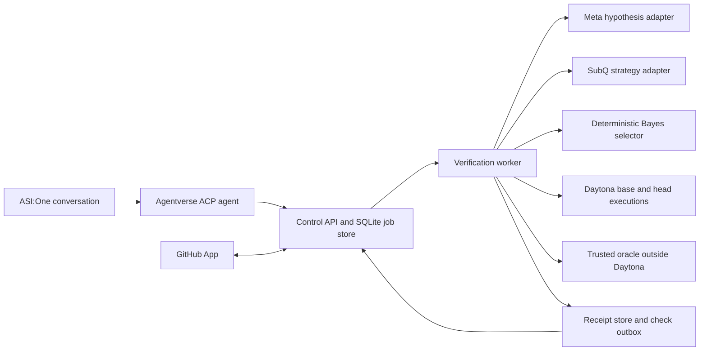

# ProofHunter

**Product requirements and implementation handoff** · v1.0 · November 7, 2026

## 1. Product and release scope

ProofHunter investigates whether an authorized GitHub pull request changes behavior that matters. A developer asks inside ASI:One, ProofHunter pins the PR to immutable base and head commits, proposes falsifiable bug hypotheses, spends a small test budget on informative inputs, and returns a verdict with a reproducible evidence receipt. The hackathon release focuses on the Fetch.ai **Agents That Prove Their Work** verification track. One public ACP agent is the runtime entry point. The implementation agents in §11 build the system in separate sessions.

**Primary user:** A maintainer reviewing an AI-generated change. **Job to be done:** Decide where to investigate before merging, with enough evidence to rerun the disputed behavior. **Success:** A judge can discover the agent and request, check, and inspect a real verification run from ASI:One. A known buggy commit produces a reproduced counterexample. A fixed commit demonstrates bounded clean coverage. An unavailable oracle or runner yields an honest inconclusive result.

| P0 hackathon release | P1 after P0 | Outside v1 |
|---|---|---|
| One enrolled, public, same-repository Python PR at a time per requester. Pure-function, integer-only checkout contract. ASI:One discovery, start, status and full counterexample summary in chat. GitHub App PR read, live Meta hypotheses, live Snap routing, Bayesian selection, Daytona execution, trusted oracle, receipts and offline replay. | GitHub check publishing once retry/reconciliation and visibility tests pass, optional webhook triggers and ASI:One cards, more enrolled contracts, measured test selection improvements. | Arbitrary repository execution, private data, forks, dependency installation from PRs, patching, automatic merge, required status checks, payments, persistent self-modification. |

Build the GitHub check and webhook adapters against mocks in P0. Enable them independently only when their P1 gates pass. The public demo uses a dedicated team-owned repo and demo PRs. Every new supported contract must be enrolled by a maintainer with a reviewed, versioned contract and invocation adapter.

### Demo contract `checkout-rounding@1`

Expose `checkout.total_cents(prices_cents: list[int], discount_percent: int) -> int` from the enrolled repo’s `checkout.py`. Valid input is 0–8 line items of 0–10,000 integer cents and an integer discount of 0–100 inclusive. Reject booleans, floats, extra keys, and out-of-range values at the boundary. The oracle uses integer arithmetic and rounds the discounted subtotal once, half up. Set `n = sum(prices_cents) * (100 - discount_percent)` and return `(n + 50) // 100`. Empty baskets and a 100% discount return 0. Invalid-input behavior is outside the enrolled contract.

Create three immutable demo revisions with the same entry point. Base and fixed head satisfy the rule. Buggy head discounts and rounds each line separately. For `[15,15,15]` at `10%`, the correct value is **41¢**, the faulty head returns **42¢**, and a separate half-even mutant returns **40¢**. A confirmation receipt requires fresh base and head observations, plus an independently reproduced head mismatch. Publish exact demo PR URLs and commit IDs in the implementation repo before live verification.

### Chat behavior

| User intent | Chat response |
|---|---|
| `Verify https://github.com/OWNER/REPO/pull/42` | Accept one canonical HTTPS GitHub PR URL on an enrolled repo. Return the full run UUID, queued state and a copyable `status <run_id>` instruction. Reject ambiguity and unauthorized repos with a scope explanation. |
| `status <run_id>` | Show phase and attempts spent while active. Show final verdict, short SHAs, evidence counts, provider modes and reason when complete. |
| `evidence <run_id>` | Show minimal reproducible input, expected/base/head/repeated head, oracle version, full pinned SHAs and replay command for a confirmed mismatch. For other outcomes show coverage, a receipt hash and limits. Optional public link is secondary. |
| `help` | Explain supported repo, commands and verdicts. |

Plain text is the baseline. Acks and response delivery follow ACP. Each request completes one chat turn, so the background verification job survives a chat turn ending. Judge can poll in the same ASI:One conversation. A public run is readable by its run ID and has a public-safe receipt. Do not treat ASI:One’s transport sender as proof of a particular person or GitHub identity. Apply a per-sender limit where available and a hard service-wide cap regardless. The app operator’s repository enrollment authorizes the public demo. Never accept a user-supplied model URL, command, oracle, Git remote, or check name.

## 2. System design



Use Python 3.12, `uv` and a locked environment, Pydantic v2 strict boundary models, FastAPI, HTTPX, SQLite WAL on a single persistent host, pytest, uAgents and the pinned Daytona client. Keep adapters thin and bind real or stub implementations at startup. One API process, one job worker, one ACP process in the demo deployment. Only the ACP transport and optional webhook route need public reachability. The chat agent calls the control API on a private origin with service authentication. CLI offline uses the same worker and receipts. Prefer an enrolled test function over general pytest discovery, which can load PR-controlled plugins and setup scripts.

### Execution lifecycle

1. Validate/normalize request, reserve quota, and queue with an idempotency key. Worker claims with a lease, resolves and records exact SHAs and repository ID, and fetches only allowlisted source files and bounded context. Treat the PR as data at every boundary.
2. Retrieve the trusted enrollment record outside the PR, hash it, and validate the domain and oracle version. No trusted oracle yields `inconclusive` before untrusted code runs.
3. Send bounded, sanitized contract plus allowed public source/diff context to Meta. Validate returned plans, map them to the supported taxonomy, and always include H0 and `other`. If the call fails, use a deterministic built-in plan with an explicit fallback label. In live smoke, fallbacks count as failed provider gates.
4. Snap chooses a candidate preparation strategy from an eligible allowlist. Generate finite inputs, score them using deterministic EIG, and run the best remaining experiment. An oracle evaluates the input outside Daytona, and the runner obtains observed outputs from exact head/base sources in isolated clean execution environments. Record the evidence and update the modeled posterior only on usable evidence. Repeat under budget. Confirmation replays the same head input in a new sandbox and has its own reserved budget.
5. Seal a receipt and persist the result and optional check outbox row in one database transaction. Return report data to ACP. Recheck current head before annotating a PR. A stale result remains tied to its original SHA, with no claim about a newer head.

### Status, limits and recovery

`queued → fetching → planning → testing → finalizing → completed`. A preterminal state may transition to `failed` for an unrecoverable internal error, or to `completed` with `inconclusive` when a dependency or trust gate prevents a valid result. Use the stage enum in status and append timestamped events. Terminal records are immutable apart from separately stored publish state and a live `is_stale` projection. Internal exceptions redact details from public views.

- Default limits per run: 180-second total worker deadline, 6 distinct paired probes plus one reserved head confirmation, 15 sandbox invocations maximum, 2 Meta requests and 3 Snap requests maximum including retries. Allow at most 64 concrete candidates, 8 hypotheses, 2 active jobs service-wide and 1 per requester bucket. Cap raw model context at 32 KiB and payloads at the schemas below. Rate limit the public entry to 6 accepted runs per hour service-wide, configurable down. Store wall clock and measured cost or unknown, and enforce budgets before spending.
- Sandbox run is a fresh instance for each side of a pair and for confirmation. Reserve time to clean up. Each invocation has a 5-second execution deadline after setup, a control-plane deadline, and 16 KiB bounded output. Deduplicate by canonical input hash. Keep candidate index and budget counter in a single transactional writer so retries cannot update beliefs twice.
- Lease claim/renewal uses compare-and-swap on owner and epoch. Commit each complete probe and stage checkpoint transactionally. On lease loss, old worker stops publishing results and schedules cleanup. On recovery, conservatively charge ambiguous allocations against budget and retry only with a fresh sandbox and fresh attempt ID. A quota-bound sweeper deletes only instances tagged with this deployment/run and recorded in its ledger. Prefer a single worker in the demo. An unavailable dependency, invalid payload, or exhausted deadline must yield an explicit reason code and partial receipt when possible.

## 3. Provider contracts and day-zero checks

Documentation status is as of November 7, 2026. **Documented** means the public API shape was cross-checked. **Live gate** means a new account or deployed build must demonstrate the behavior before claiming it works. Pin package versions and record sanitized request ID, UTC timestamp, status, and configuration fingerprint in `docs/provider-smoke.md`. The implementation defaults to offline mode until an operator enables live profiles.

### Meta Model API · hypothesis generation

**Documented:** OpenAI-compatible `POST https://api.meta.ai/v1/chat/completions`, Bearer `MODEL_API_KEY`, model `muse-spark-1.3`, structured output via `response_format` with `type: json_schema` and named strict schema. Use the Meta Model API account and endpoint. Send system policy plus user data separated into typed fields. Check choice/finish reason/refusal, enforce byte limits, and validate the inner JSON with the same local schema regardless of provider validation. Use a bounded response budget and at most one retry for transient transport or 429/5xx if time permits. No tool calls. Never apply Meta-suggested expected outputs as ground truth. **Live gate:** one constrained response against the public demo schema, entitlement, latency, field compatibility, and approved data handling. Confirm current token limit parameter and schema subset against the pinned request. [Meta overview](https://dev.meta.ai/docs/overview) · [Meta structured output](https://dev.meta.ai/docs/cookbook/structured-output)

### SubQ Snap 1.1 · next preparation action

**Documented:** Bearer `SUBQ_API_KEY`, `POST https://api.subq.ai/v1/systemone` with `model`, `state`, `questions`. Model ID `subq-snap-1.1`, public preview. Verify account access with `GET https://api.subq.ai/v1/models` and one actual decision. The `choice` result includes the chosen key, option probabilities and confidence. Example request:

```json
{
  "model": "subq-snap-1.1",
  "state": {"contract":"checkout-rounding@1","coverage":[],"remaining_pairs":6},
  "questions": {
    "next_action": {
      "type": "choice",
      "instructions": "Choose among the eligible preparation actions for the next probe.",
      "criteria": {
        "boundary": "Enumerate discount endpoints and half-cent boundaries",
        "constraint": "Search for inputs on which candidate behaviors disagree",
        "seeded_fuzz": "Sample remaining legal, uncovered inputs"
      }
    }
  }
}
```

Read `answers.next_action.choice` and validate that the answer type and choice match the exact offered keys. Validate optional probabilities as finite, bounded and normalized within 0.01 if present. Missing or invalid decisions use the deterministic fallback sequence `constraint`, `boundary`, `seeded_fuzz` among eligible actions. If only one is eligible, use it without a provider call. Run Snap on the first two adaptive selection steps while alternatives and budget remain, with at most one transient retry total. After that, use the fallback sequence with mode `policy` and reason `call_budget`. Log the chosen strategy, alternatives, mode and sanitized request metadata. The route narrows the next candidate batch. Snap confidence is stored separately from the Bayesian prior/posterior. **Live gate:** confirm model visibility, parse a real `choice`, show its selected strategy actually affected the candidate batch, and verify account limits. [SubQ Decisions API](https://docs.subq.ai/endpoints/decisions-api) · [SubQ API overview](https://docs.subq.ai/using-the-api/)

### Fetch.ai · Agentverse, ASI:One and Agent Chat Protocol

**Documented:** ACP here means Fetch.ai **Agent Chat Protocol**. Use `Agent`, `Context` and `Protocol` from `uagents`; use `ChatMessage`, `ChatAcknowledgement`, `TextContent`, `EndSessionContent` and `chat_protocol_spec` from `uagents_core.contrib.protocols.chat`. Bind `Protocol(spec=chat_protocol_spec)`, include with `publish_manifest=True`, promptly ACK each inbound message ID, and send a text response with the documented end-session content for the completed turn. Handle acknowledgements without creating a loop. Use a stable `AGENT_SEED_PHRASE`, create and connect a mailbox in Agentverse using the documented flow for the chosen release, and publish agent description, keywords, examples and manifest. Prefer one stable registered mailbox for the demo. Persist ACP message ID deduplication and return the same run ID on redelivery. **Live gate:** test discoverability by descriptive query in a fresh ASI:One conversation, invocation by address, follow-up polling and terminal evidence rendering. Check mailbox key/registration mechanism against the pinned SDK. Verify cards with the official client if enabled. [Agentverse registration](https://innovationlab.fetch.ai/resources/docs/next/agentverse/agentverse-sdk-uagents) · [uAgents ASI:One examples](https://uagents.fetch.ai/docs/examples/asi-1) · [Interactive Cards](https://innovationlab.fetch.ai/resources/docs/interactive-cards/asi-interactive-cards)

### Daytona · sandbox execution

**Default:** Pin a tested stable v0 client and use its matching documentation. The stable API documents `Daytona`, `CreateSandboxFromSnapshotParams(snapshot=..., public=False, network_block_all=True)`, `sandbox.fs.upload_file`, `sandbox.process.exec(command, cwd=..., timeout=...)` and deletion. Use only a constant command to start the trusted wrapper, which receives data in a bounded uploaded JSON file. Do not mix in v2 calls. Daytona separately documents a v2 alpha example using `daytona==2.0.0a8`, `daytona.v2.create`, `sandbox.exec(argv=..., execution_timeout=...)` and `daytona.v2.delete`. Switching to v2 requires equivalent live isolation, upload, resource and teardown tests. [Stable Python process API](https://www.daytona.io/docs/en/python-sdk/sync/process/) · [Stable Daytona client](https://www.daytona.io/docs/en/python-sdk/sync/daytona/) · [Daytona v2 Python SDK](https://www.daytona.com/docs/python-sdk)

**Live gate:** prove that the account and snapshot support strict egress denial before uploading any PR code. Stable docs describe per-sandbox block-all overrides for Tier 3/4 and essential-services access on default lower-tier policy. Run a trusted canary from the same snapshot and configuration, test denied DNS/HTTPS to a controlled destination and known essential services, test denied link-local/cloud-metadata access and inspect effective policy. Check SDK upload/control-plane connectivity, private ingress, CPU/memory limits, actual timeout behavior, process cleanup, and deletion. If account capability or the canary fails, live untrusted execution stays disabled. Offline fixture simulation is available with explicit labeling. [Daytona network policies](https://www.daytona.io/docs/en/network-limits/) · [Daytona snapshots](https://www.daytona.io/docs/en/snapshots/)

### GitHub · pinned source and advisory Check Runs

**Documented:** App private key signs a short-lived App JWT. Exchange for a repository-scoped installation token via `POST /app/installations/{installation_id}/access_tokens`. Grant `Contents: read`, `Pull requests: read`, and automatic `Metadata: read`. Add `Checks: write` only if publishing is enabled. Treat installation tokens as opaque and respect their expiry. Send a pinned, supported `X-GitHub-Api-Version`, with `2026-03-10` as the version to smoke-test. Resolve via `GET /repos/{owner}/{repo}/pulls/{number}` and pin `base.sha`, `head.sha`, repository IDs and PR number before any source fetch. Fetch allowed paths via `GET /repos/{owner}/{repo}/contents/{path}?ref={sha}` for the same repository. Reject forks, missing refs, symlinks, submodules, LFS pointers and oversize/unsupported responses before execution. Validate mode `100644` and type `blob` at the exact commit tree and check blob ID against the content response, because the contents endpoint can resolve symlinks. Accept at most 64 KiB of UTF-8 source per side. Ship only `checkout.py` in the sandbox source package and use bounded excerpts/diff and trusted contract for model context. Compute the diff locally. Do not clone, fetch arbitrary URLs or execute Git hooks. [App installation tokens](https://docs.github.com/en/apps/creating-github-apps/authenticating-with-a-github-app/generating-an-installation-access-token-for-a-github-app) · [Pull Requests REST API](https://docs.github.com/en/rest/pulls/pulls#get-a-pull-request) · [Repository contents](https://docs.github.com/en/rest/repos/contents#get-repository-content)

**Check Runs:** Use `POST /repos/{owner}/{repo}/check-runs` and `PATCH /repos/{owner}/{repo}/check-runs/{check_run_id}` when needed. Create a completed advisory result with `head_sha`, stable `external_id` = run ID, status/conclusion and redacted output. Map confirmed regression to `failure`, bounded clean to `success`, and pre-existing defect/inconclusive/infrastructure failure to `neutral`. Use a feature flag default off, with no branch protection configuration. Store the check ID and outbox attempts. On ambiguous create, reconcile by listing app check runs on the commit and matching `external_id` before retrying. If ambiguity persists, hold publication for operator review, avoiding a blind POST. Test stale head and publication replay on a throwaway authorized repo. [Check Runs REST API](https://docs.github.com/en/rest/checks/runs)

**Webhooks:** Optional route handles `pull_request` `opened`, `reopened`, and `synchronize`. Enforce request size, verify `X-Hub-Signature-256` HMAC-SHA256 over raw bytes with constant-time comparison before JSON parsing, and persist `X-GitHub-Delivery` dedupe plus event fingerprint in the same transaction as enqueue. Validate event, installation ID, repository ID, allowed action, and strict SHA format. Respond quickly, re-fetch PR and treat a mismatched head as stale event. Run disabled by default. **Live gate:** confirm app installation permissions, GitHub delivery and replay behavior, and evidence is bound to the actual head. [Webhook signature validation](https://docs.github.com/en/webhooks/using-webhooks/validating-webhook-deliveries)

## 4. Bayesian experiment selection

### State, generators and likelihoods

The v1 hypothesis space is one dominant failure mode per probe model. `H0` means modeled correct behavior. Implement predictors for `per_item_rounding`, `half_even_rounding` and `other`. More hypotheses require reviewed predictors and a likelihood version bump. The oracle implements the actual enrolled contract separately from the predictors. Interpret the modeled posterior as a prioritization estimate conditional on these hypotheses and likelihoods. Multiple concurrent defects and unmodeled behavior can violate the assumptions.

Meta supplies up to six hypotheses in a `HypothesisPlan`. Each proposal contains `mode`, `rationale`, `source_refs`, `suggested_strategy` and a bounded `constraints` object. Dedupe by taxonomy, reject unsupported modes, and use a built-in hypothesis plan if the provider produces no valid proposals. Deterministic code owns all priors. Use raw weights `H0=.60`, `per_item_rounding=.15`, `half_even_rounding=.15`, `other=.10`; renormalize over retained modes. When only mandatory H0 and `other` survive validation, use the built-in plan to restore supported alternatives. Persist `prior_policy=v1` and actual initial vector.

| Generator | Implementation |
|---|---|
| `boundary` | Enumerate empty/singleton/multi-item inputs, discounts at 0, 1, 50, 99, 100, values near domain limits and half-cent ties. Add the fixed demo sentinel to the bounded candidate bank. |
| `constraint` | Search a bounded integer grid, prioritizing supported plan constraints and inputs where predictors disagree. Include `[15,15,15]` at `10%` and other disclosed development seeds as ordinary candidates. Exact arithmetic throughout. |
| `seeded_fuzz` | Use versioned pseudorandom sampling from the legal domain, biased toward small baskets and varied fractional residues, with an explicit per-run seed. Include the demo sentinel in the initial common candidate bank. |

Generate a canonical input bank up to the total bound of 64 unique inputs. Allocate up to 20 per strategy, plus up to four common anchors, including the sentinel. Deduplicate by input hash across iterations. Available Snap actions have at least one unseen valid candidate. For each selected strategy, rank its unseen candidates plus unused common anchors. For clean coverage require successful exact-base/exact-head matches for all tags `empty`, `zero_discount`, `full_discount`, `half_cent`, `multi_item`. A probe may satisfy several tags. Common anchors are `([],17)`, `([1,2],0)`, `([99],100)`, and `([15,15,15],10)` as `(prices, discount)` pairs. The sentinel satisfies half-cent and multi-item coverage. If remaining pair budget is at most the number of missing tags, force a candidate that covers a missing tag and record `coverage_guard`. This override is deterministic. Hold out the final head replay from ordinary probing. Pin an offline fixture candidate bank in which the sentinel is the unique highest-EIG input at the first step. Use the same selector, oracle and verdict code as live. The actual live counterexample may differ.

Define binary observation `Y ∈ {match,mismatch}` relative to the oracle, only for a well-formed head result with a base observation that matches the oracle. For each retained mode `h`, derive `q_h(x)=P(mismatch|h,x)` from versioned likelihood policy `rounding-likelihood-v1`:

- `H0`: `q=.02` on all legal inputs.
- Mode with a deterministic predictor: `q=.98` when its prediction differs from the H0 model prediction and `.02` otherwise. Compute the H0 model prediction with a pure integer predictor. Actual evidence always compares with the independent enrolled oracle.
- `other`: `q=.20` on all legal inputs as an explicit modeling assumption.

`match` likelihood is `1-q`. Use double-precision deterministic math, finite checks and strictly interior likelihoods. For each candidate compute the two outcome probabilities and posteriors, then score:

```text
P(y|x,D) = Σ_h P(y|h,x) * P(h|D)
P(h|D,x,y) = P(y|h,x) * P(h|D) / P(y|x,D)
H(p) = -Σ_h p_h log2(p_h), with 0 log2 0 = 0
EIG(x) = H(P(H|D)) - Σ_y P(y|x,D) * H(P(H|D,x,y))
```

Rank by descending EIG rounded to 12 decimals for tie purposes, then ascending canonical SHA-256. Treat negative EIG within floating-point epsilon as zero and larger negatives as calculation errors. Selection compares experiments with equal budgeted cost in v1. Record the candidate pool hash, chosen input, strategy, prediction and likelihood vectors, EIG bits, prior and posterior vectors and reason. The head confirmation is evidence about reproducibility of the original observation and never contributes a second update. A base mismatch, timeout, exception, malformed output, trust failure, or duplicate triggers an explicit exclusion without a posterior update. Stop early on confirmed evidence, an unresolvable trust failure, or exhausted inputs/budget. Posterior thresholds do not set verdicts.

**Reference vector:** For the demo input, with all four hypotheses present, the mismatch likelihood vector is `[.02,.98,.98,.20]` in the order `H0, per_item_rounding, half_even_rounding, other`. `P(mismatch)=.326`. A valid head mismatch yields a posterior of about `[.03681,.45092,.45092,.06135]`. It favors both rounding hypotheses because `Y` is binary. The observed numeric value supports a separate explanatory note about which predictor matches 42. Neither explanation changes the evidence claim.

## 5. Trusted oracles, replay and verdicts

### Trust and execution policy

- `T1` enrolled reference or literal expected output derived from a reviewed contract, versioned and maintained separately from the target repository. Evaluate on the control plane. In v1, only a `T1` exact-match comparator can confer a terminal evidence-backed verdict.
- `T2` reviewed metamorphic property with explicit preconditions, such as permutation invariance. Allow as supporting evidence in a later contract. It cannot prove the rounding rule by itself.
- `T3` differential behavior against base or existing test output without an authoritative contract. Use for a finding with `inconclusive` status. Base can contain the same defect. Model commentary and tests from the PR are context only.

Compute expected value before invoking the target. The trusted runner wrapper launches the target in a restricted child process inside Daytona, returning one strictly parsed integer output envelope, or an explicit unusable status. Keep the expectation and oracle out of the sandbox. The base, head and confirmation runs share a pinned trusted image, wrapper and input, with independent fresh instances. Protect the control plane by rejecting arbitrary execution parameters, escaping hostile text on output, and treating stdout, stderr, apparent child exit behavior and every JSON value as untrusted observations. A target may deliberately emulate correct behavior on sampled inputs. Evidence establishes behavior for the captured input and runtime configuration.

| Verdict | Required evidence | User-facing wording |
|---|---|---|
| `confirmed_regression` | T1 expected value, valid base = expected, valid head ≠ expected, and valid fresh head replay equals the initial mismatching head. All bound to identical input/contract and pinned execution provenance. | Reproduced regression on this head. Review before merging. |
| `confirmed_existing_defect` | T1 expected, base and head return the same non-expected value, and fresh head replay returns the same mismatch. | Reproduced defect present in both revisions. |
| `no_defect_found` | At least three distinct usable paired matches, all required coverage tags, zero observed mismatch or unresolved attempts, T1 oracle and valid isolation provenance. | No defect found in the reported scope and test budget. |
| `inconclusive` | Untrusted or absent oracle, isolation/provider issue blocking execution, disagreement or flake on replay, changed pre-existing mismatch, unsupported contract, insufficient coverage, or other unresolved evidence. | Show reason, completed probes and the next missing requirement. |

Confirmed results take precedence over earlier incomplete attempts if the confirmation chain meets every gate. A `failed` internal job has no valid verdict and reports a sanitized error. Stub mode uses identical comparison logic but every screen, CLI result and receipt is marked `offline_fixture`. Never translate that result to an actual GitHub check. Expose an exact replay command and instructions to resolve the archived code and trusted harness independently. Hash the canonical public receipt for integrity. The hash binds the record bytes and execution metadata as stored by ProofHunter. It provides no independent proof of provider behavior. A signed receipt with a publicly verifiable key can be added later.

## 6. Versioned data contracts and API

### Shared module `src/proofhunter/contracts.py`

Setup authors these names and freezes `schema_version="1.0"` with JSON Schema snapshots and one sample per boundary. Types below are normative. Use strict integers, explicit nulls for unavailable values where marked, bounded lists and strings, `extra="forbid"` for inputs, enums for machine states, UTC ISO 8601 timestamps, lowercase hex and UUIDv4 run IDs. Evidence contains no floats other than defined model/statistical measurements, which must be finite and rounded to 12 decimals before hashing. Canonical encoding uses sorted object keys, compact separators, UTF-8, explicit nulls, and NaN rejection. Preserve array order. `receipt_sha256` is excluded from its own hash. Document the canonical serializer and test against a fixed golden vector.

| Model | Required fields and limits |
|---|---|
| `PrTarget` | `owner`, `repo` ASCII path segments (1–100 each), `number` positive int, `repo_id` and `installation_id` positive ints assigned server-side. `PinnedRevision` adds `base_sha`, `head_sha` exact 40-hex and `resolved_at` UTC. |
| `Enrollment` | `repo_id`, canonical `owner/repo`, `installation_id`, allowlisted `source_path="checkout.py"`, `entrypoint="checkout.total_cents"`, `contract_id="checkout-rounding@1"`, `contract_sha256`, `oracle_version`, `harness_version` and `snapshot_id` with immutable image digest. Record stays in trusted config. |
| `RunRequest` | `pr_url` length ≤512, optional nonnegative 32-bit `seed`. Server assigns requester bucket, budgets, mode and protocol policy. `RunStatus` contains `run_id`, `status`, `created_at`, `updated_at`, `is_stale` (bool or null), `attempts_used`, `budget`, `verdict` (nullable), `reason_code` (nullable) and `receipt_sha256` (nullable). |
| `HypothesisPlan` | `hypotheses` list length ≤6 of `{mode, rationale, source_refs, suggested_strategy, constraints}`. `mode` enum `per_item_rounding/half_even_rounding/other`; rationale ≤300 chars, refs ≤4 bounded relative path plus positive line number within supplied context, strategy enum above; constraints fields `min_items`, `max_items` (0–8), `discount_percent` (0–100) and `require_fractional_cent` boolean, all nullable. `min_items ≤ max_items` when both specified. Only the local app assigns canonical IDs. |
| `CandidateInput` | `prices_cents` and `discount_percent` as in §1. `Candidate` adds `input_sha256`, `strategy`, sorted deduplicated `coverage_tags` and `generator_version`. |
| `RouteDecision` | `choice`, `eligible[]`, `mode` (`live/stub/fallback/policy`), nullable `model_id`, `probabilities`, `confidence`, `provider_request_id`, `latency_ms`, `reason_code`. Eligible actions and outcome must agree. Expose only redacted routing metadata publicly. |
| `SandboxObservation` | `attempt_id`, `side` (`base/head/confirm`), `commit_sha`, `source_sha256`, `input_sha256`, `runner_mode` (`daytona/offline_fixture`), `snapshot_id`, `image_digest`, `harness_sha256`, nullable `sandbox_id` (operator only), `started_at`, `duration_ms`, `outcome` (`ok/timeout/nonzero/invalid/denied/infra_error`), nullable `value`, `exit_code`, `stdout_sha256`, `stderr_sha256`, `truncated`. `value` is an integer only on `ok`; negative or out-of-contract integer outputs can be valid mismatching observations if representable within signed 64-bit. |
| `OracleResult` | `contract_id`, `contract_sha256`, `oracle_version`, `input_sha256`, `trust_tier`, `expected_cents` (nullable), `status` (`ok/unavailable/invalid`). Reference result never enters target environments. |
| `ProbeRecord` | `probe_no`, `candidate`, `candidate_pool_sha256`, `route`, `oracle`, `base`, `head`, nullable `confirmation`, `prior`, `posterior` (nullable if excluded), `likelihood_mismatch`, `eig_bits`, `evidence_kind`, `exclusion_reason` (nullable). Key all model vectors by canonical hypothesis ID. Persist unpaired attempts separately if interrupted. |
| `ReceiptV1` | `schema_version`, `run_id`, `pinned_revision`, `source_file_sha256` (nullable `{base,head}` map), `enrollment_fingerprint`, `execution_mode`, `providers`, `budget`, `seed`, `policy_versions`, `hypotheses`, `probes`, `unpaired_attempt_summaries`, `coverage`, `verdict`, `reason_code`, `replay`, `created_at`, `completed_at`, `receipt_sha256`. Public projection excludes raw prompts, sources, output bytes, operator IDs including `installation_id`, and credentials. Use a public revision DTO without operator identifiers. If early pinning fails, `pinned_revision` can be null and no executable replay is emitted. |
| `ErrorEnvelope` | `error: {code, message, request_id, retryable}`. Reason codes include `invalid_pr_url`, `repo_not_enrolled`, `fork_unsupported`, `revision_unavailable`, `oracle_unavailable`, `isolation_unverified`, `provider_unavailable`, `budget_exhausted`, `nondeterministic`, `coverage_insufficient`, `stale_event`, `conflicting_idempotency_key`, `internal_error`. |

### Internal callable interfaces

Use asynchronous adapter calls for external I/O and pure synchronous functions for local math and oracles. `ports.py` specifies typed Protocols and the call boundaries below. DTOs such as `SourceBundle`, `PlanningContext`, `DecisionState`, `ExecutionRequest` and `ProbeSelection` are defined in setup and used by all agents.

```text
SourcePort.pin(target: PrTarget) -> PinnedRevision
SourcePort.fetch(revision: PinnedRevision, enrollment: Enrollment) -> SourceBundle
MetaPort.propose(context: PlanningContext) -> HypothesisPlan
RoutePort.choose(state: DecisionState, eligible: tuple[Strategy, ...]) -> RouteDecision
generate(plan: HypothesisPlan, seed: int) -> CandidateBank
select(belief: Belief, candidates: Sequence[Candidate], policy: SelectionPolicy) -> ProbeSelection
update(belief: Belief, selection: ProbeSelection, observed: BinaryOutcome) -> Belief
RunnerPort.observe(request: ExecutionRequest) -> SandboxObservation
evaluate(enrollment: Enrollment, candidate: Candidate) -> OracleResult
classify(probes: Sequence[ProbeRecord], coverage: Coverage, stop_reason: ReasonCode) -> VerdictResult
seal(receipt: ReceiptV1) -> ReceiptV1
CheckPort.publish(intent: CheckIntent) -> PublishResult
RunStore.claim(worker_id: str, lease_seconds: int) -> RunLease | None
RunStore.checkpoint(lease: RunLease, event: RunEvent) -> None
RunStore.record_attempt(lease: RunLease, attempt: AttemptRecord) -> None
RunStore.commit_probe(lease: RunLease, probe: ProbeRecord) -> None
RunStore.finish(lease: RunLease, receipt: ReceiptV1, check: CheckIntent | None) -> None
```

`ExecutionRequest` contains run/attempt ID, immutable source bytes plus hash, SHA, side, input, resource/timeout policy and enrolled snapshot/harness identifiers. It carries no expected result. `SourceBundle` has separately verified base/head bytes, their hashes and bounded model context. `ProbeSelection` records candidate, EIG, likelihoods and pool hash. `Budget` records limits and consumed counts for pairs, attempts, confirmation and provider calls, plus wall-clock deadline and cost or unknown. `Coverage` lists required, observed and missing tags plus distinct usable pair count. `Replay` binds the original input, SHAs, source and harness hashes, contract/version, snapshot/image, and a shell-ready command built only from trusted flags and validated identifiers. `RunLease` carries run ID, owner, epoch and expiration. Setup provides fixture implementations as wire-contract examples. Return typed adapter failures with retryability and keep original provider bodies out of public errors.

### HTTP interface

Use JSON and bearer service authentication on `/v1/*`. Validate fixed origin configuration at startup. `GET /healthz` only indicates process liveness. Internal `GET /readyz` checks database schema, worker heartbeat and required mode configuration, without calling providers on each request. Return no secrets. Limit JSON inputs to 8 KiB and webhook raw body to 256 KiB. FastAPI generates OpenAPI from the frozen models. Preserve a stable error envelope.

| Method and path | Request and response |
|---|---|
| `POST /v1/runs` | `RunRequest`, required `Idempotency-Key` 1–128 ASCII characters. `202 RunStatus`, including on same key and same canonical request, `409` on changed body under that key. `422` invalid URL/body, `403` unenrolled repo, `429` quota with `Retry-After`. ACP maps inbound message ID to the key. |
| `GET /v1/runs/{run_id}` | `200 RunStatus`, `404` unknown or outside scope. Include coverage progress and mode in optional status detail. |
| `GET /v1/runs/{run_id}/receipt` | `200 ReceiptV1` sealed public projection. `409 receipt_pending` while active, `404` unknown. Return `ETag` derived from receipt hash. Retained pinned receipt stays immutable when head moves. |
| `POST /v1/runs/{run_id}/replays` | Internal endpoint with a separate operator credential, `Idempotency-Key` and `{probe_no}`. `202 RunStatus` for a new run replaying the original pinned base/head and input with parent receipt hash. `409` if no eligible pinned input or source unavailable. This run is marked `replay`, bypasses Meta and Snap, and gets its own receipt and quota reservation. |
| `POST /webhooks/github` | Optional public route. `202` for validated/enqueued, `200` for authenticated duplicates or irrelevant events, `401` for invalid signature, `400/413` for malformed/oversize. Disabled returns `404`. |

Use SQLite migrations for `runs`, `idempotency_keys`, `inbound_messages`, `webhook_deliveries`, `run_events`, `attempts`, `probes`, `receipts`, `check_outbox`, and quota counters. Unique `(requester_scope,key)`, `delivery_id`, `(run_id,attempt_id)`, `(run_id,input_sha256,side)` for committed logical observations and one terminal receipt per run. Keep append-only raw attempt IDs distinct from logical observation keys. Store one receipt and one optional outbox row transactionally. Apply `busy_timeout`, bounded retries, foreign keys, and local persistent disk. Egress to providers is outside DB transactions. Store no raw model responses, arbitrary sandbox output or private source in public views. Keep sanitized operational records for seven days and public demo receipts for thirty days by default, then purge. Persist exact public source byte hashes and enrolled fetch instructions for replay after receipt expiry if the operator archives a demo bundle.

## 7. Security acceptance criteria

| Threat | Required control and verification |
|---|---|
| SSRF or scope escape | Parse with a real URL parser and validate canonical authority `github.com`, HTTPS, no user info/port/query/fragment/percent escapes, exactly `/owner/repo/pull/positive-int`; reject encoded separators, Unicode and overflow. Compare normalized names plus immutable GitHub repo/installation IDs. Construct paths against fixed `api.github.com` origin. Reject source redirects. Enforce same-repo head and base. Check that enrollment repo is public. |
| Malicious target or dependency | Strict egress denial, private sandbox, no public previews, secrets, host mounts, persistent volume, writable shared cache, checkout hooks, network installation or target build scripts. Use an image built by the team from pinned dependencies, preinstalled before sandbox creation, and verified by digest. Start a constrained child with minimal env, fixed working directory, resource/process limits and no user command interpolation. Keep one source revision per sandbox. |
| Target forges evidence or corrupts replay | Runner output is hostile data, parsed as one strict bounded envelope with separate outcome metadata. Oracle, run ledger, expected values and artifact hashing stay outside Daytona. Verify bound input/source/image/harness hashes and stable head replay. Force cleanup on timeout, cap streams while reading and record truncation. Drop malformed or oversized envelopes as unusable. |
| Prompt injection or provider leakage | Repo text is data, no tools exposed to the hypothesis model, structured schema plus enums/range/source-reference validation, route allowlists and action-budget enforcement. Strip credentials and sensitive tokens before provider calls. If redaction or scope verification is uncertain, withhold context and use labeled fallback. ASI receipts contain no raw diff, logs or prompts. |
| Chat replay, webhooks and denial of service | Idempotent ACP requests, exact raw-body HMAC verification, persisted delivery IDs, per-bucket and global rate/concurrency/cost limits, size/time bounds, worker lease fencing and budget accounting. Cross-check completed reports against the pinned head. |
| Credential handling and user-visible claims | Different secrets for control API, GitHub, ACP, Meta, SubQ and Daytona. Keep only scoped tokens in service memory. Redact auth headers and provider payloads in logs. Disable private repos and check publishing by default. Render escaped output, versioned limits, and an explicit offline label whenever fixture execution is used. |

Adversarial test inputs include URL userinfo/Unicode/escaped path, fork PR, moving head, symlink path, unexpected checkout bytes, oversized source/output, booleans as integers, process timeouts and surviving descendants, output trying to spoof a report, source prompt injection, missing oracle, bad/duplicate webhook, duplicate ACP ID, expired lease, interrupted publication and cross-run state contamination. Test egress and secret absence using benign canaries before any target upload. The independent verifier records command and redacted observation per critical check.

## 8. Benchmark and evaluation protocol

### Dataset and splits

Prepare a versioned corpus of at least 48 isolated, enrolled `checkout.py` cases: 12 development cases and 36 held-out cases, including at least 24 distinct defective cases and 12 clean variants in holdout. Use original reviewed implementations and mutants for per-line rounding, half-even/floor, aggregate order, ignored or clamped discounts, item-count and boundary behavior, plus clean refactors. Include negative infrastructure scenarios in a separate adversarial suite. Group splits by behavior template, keeping near-duplicate edits in one split. Each case has a stable ID, source hashes, contract version and a frozen label with an independently prepared witness or review rationale. Keep held-out labels and witnesses out of model prompts, generator tuning and agents’ authoring worktrees. The bench agent builds the runner and a sample. The final verifier owns a separate frozen holdout before running comparisons, may commit it after reporting, and documents any prior exposure.

### Arms and controls

| Arm | Purpose |
|---|---|
| Deterministic fixed boundary order | Strong simple baseline. Freeze order on the dev set. |
| Uniform random | Draw from the same precomputed candidate bank as EIG. Use at least five preregistered seeds and pair them with EIG. |
| EIG with deterministic routing | Isolate the value of deterministic adaptive selection. Compare to random under the same fixed all-strategy candidate availability for the controlled ablation. |
| Meta + Snap + EIG | Compare live or explicitly recorded model routing to deterministic routing at the same paired execution budget. Snap can restrict the next batch from the same underlying bank. Hold Meta hypothesis inputs fixed between the two routing arms for this ablation. |

Same oracles, timeouts, confirmation rules, enrolled source bytes, trusted harness and pair count across arms. Count base, head and confirmation invocations separately in the cost table. Freeze seeds, policies, budgets, source hashes and versions before evaluation. An offline corpus runner may simulate the Daytona transport but must execute only reviewed first-party fixture implementations through a controlled local bench harness or verified fixed observation transcripts. Use a small balanced Daytona subset to measure actual execution latency and provider cost. Report offline, recorded and live results separately. When a provider falls back, report the attempted mode and fallback rate. Never present measured fixture timings as cloud timings.

Report per-arm detection recall by budget `1..6`, confirmed false positives on clean controls, median pairs to first confirmed witness with censored misses shown separately, inconclusive rate by reason, total sandbox invocations, p50/p95 latency, and actual provider usage/cost when available. Use paired differences with an interval bootstrapped by case, and publish raw JSONL/CSV, versioned corpus manifest and replay commands. Report Brier score/reliability only if hypothesis labels are suitable and sample size supports it. Keep held-out results descriptive and avoid a superiority claim without support. No advantage is required to ship an honest demo.

### Release gates

| Gate | Pass condition |
|---|---|
| Evidence | Buggy fixture repeatedly yields 41/41/42/42 for expected/base/head/confirmation. Fixed fixture satisfies coverage and yields `no_defect_found`. Pre-existing and flaky cases map to their declared results. Tampered receipt hash fails replay verification. |
| Safety | Critical tests in §7 pass, including fail-closed live isolation. Zero confirmed false positives on the frozen clean corpus. Provider outages, malformed outputs and timeout fault injection preserve honest modes and receipt integrity. |
| Reproducibility | Clean checkout + `uv sync --locked` + commands below produce equivalent normalized offline receipts for same seed, ignoring IDs/timestamps/durations; golden math vector and canonical hash pass. Fresh human judge can reproduce the demo evidence. |
| Live demo | Public agent is discoverable and usable from ASI:One. A fresh judge conversation shows a real GitHub PR pin, successful Meta and Snap calls, and actual Daytona evidence with matching trusted oracle. Live path completes within 180 seconds worker time on three consecutive staged runs, or the verifier marks the latency gate as failed. |
| Benchmark | Manifest, raw results, methods, confidence intervals and honest interpretation are attached. Aim to find more defects within three probes than uniform random. Treat that as a measured target. |

## 9. Repository, local commands and deployment

```text
proofhunter/
  ProofHunter-PRD.md
  pyproject.toml · uv.lock · .python-version · .env.example · .gitignore
  README.md · config/enrollments.example.json
  schemas/                         # frozen JSON schemas and sample wire payloads
  src/proofhunter/
    contracts.py · ports.py · config.py
    github/ · meta/ · snap/ · bayes/ · runner/ · oracle/ · acp/ · store/
    api.py · worker.py · pipeline.py · cli.py · __main__.py
  fixtures/demo/                   # trusted contract, base, buggy, fixed snapshots
  tests/{contracts,github,meta,snap,bayes,runner,oracle,acp,store,integration}/
  bench/ · tests/bench/
  tools/gate.py · docs/ · ops/ · .github/workflows/
```

Implement these exact command entry points. `--offline` injects fixture source, model plans, decisions and runner with no network or credentials. The smoke commands below are future implementation requirements, while the coordination runner in §12 runs now.

```bash
uv sync --locked
uv run --locked pytest -q
uv run --locked python -m proofhunter demo --offline --case buggy --seed 17 --receipt ./buggy-receipt.json
uv run --locked python -m proofhunter demo --offline --case fixed --seed 17 --receipt ./fixed-receipt.json
uv run --locked python -m proofhunter replay --offline --receipt ./buggy-receipt.json --probe counterexample
uv run --locked python -m bench.run --offline --split sample --seed 17 --output ./bench-results.jsonl
uv run --locked python -m proofhunter serve --profile offline
uv run --locked python -m proofhunter worker --profile offline
```

`demo` exits 0 for a successfully produced terminal receipt regardless of evidence-backed verdict, and nonzero on command or internal job failure. `replay` verifies the receipt’s canonical hash first and returns nonzero on tamper, missing artifacts, mode mismatch or non-reproduction. `--probe counterexample` selects the receipt’s confirming probe. For a live receipt the authorized operator uses `uv run --locked python -m proofhunter replay --profile live --receipt ./live-receipt.json --probe counterexample` with the enrolled source and image and the same isolation gate. `serve` binds privately by default, `worker` polls the same DB, and `python -m proofhunter.acp` starts the separate chat process. Configure ignored local state for `.venv`, `.env`, database, logs and demo outputs. Pin image and Python versions in the release manifest. CI runs offline contract, regression and adversarial suites without provider credentials.

### Configuration ownership

| Variable | Used by |
|---|---|
| `PROOFHUNTER_PROFILE=offline` or `live`, `PROOFHUNTER_DB_PATH`, `PROOFHUNTER_ENROLLMENTS`, `PROOFHUNTER_API_TOKEN`, `PROOFHUNTER_API_BASE`, `PROOFHUNTER_OPERATOR_TOKEN` | Control API and worker as needed. ACP client receives only the service token and API base. |
| `MODEL_API_KEY`, `META_MODEL=muse-spark-1.3`, `SUBQ_API_KEY`, `SUBQ_MODEL=subq-snap-1.1` | Model adapters in worker only |
| `DAYTONA_API_KEY`, `DAYTONA_API_URL` if required by the pinned client, `DAYTONA_SNAPSHOT`, `DAYTONA_IMAGE_DIGEST`, `PROOFHUNTER_ENABLE_LIVE_RUNNER=false` | Sandbox worker only, config must match tested isolation fingerprint |
| `GITHUB_APP_ID`, `GITHUB_PRIVATE_KEY_PATH`, `GITHUB_API_VERSION`, `GITHUB_WEBHOOK_SECRET`, `PROOFHUNTER_ENABLE_GITHUB_WEBHOOK=false`, `PROOFHUNTER_ENABLE_GITHUB_CHECKS=false` | GitHub worker and webhook handler as required, keys scoped separately |
| `AGENT_SEED_PHRASE` plus provider-required mailbox credentials | ACP process only. Setup maps the pinned SDK’s mailbox variables and documents operator steps. |

### Rollout and demo timeline

1. **Foundation, first 45 minutes target.** Freeze shared DTOs/ports, fixtures, CLI hooks and dependency lock. Operator in parallel provisions the public demo repo, keys, mailbox and Daytona tier while recording account gates. Time estimates are planning targets.
2. **Offline vertical slice, next 2–3 hours target.** Integrate adapters with fixtures and verify buggy/fixed/refusal paths. Fail closed by default. Start corpus work in parallel after the setup gate.
3. **Live private staging, next 1–2 hours target.** Verify Meta, Snap, GitHub source pin and Daytona isolation independently. Deploy API/worker on one persistent host and register ACP. Use the public fixture only. Enable live runner and discovery after staging gates. Confirm source hashes, sandbox teardown and redacted output. Keep checks/webhooks off until separately tested.
4. **Independent release review.** Use a fresh ASI:One account/conversation where possible, confirm discovery by description and direct invocation, run the live buggy/fixed cases, then record evidence and sample offline results. If a live dependency blocks release, present a clearly labeled fixture walkthrough and the blocker. Disable intake via config on incident, drain jobs, turn off publishing, clean tagged sandboxes and restore last known-good deployment or revert to offline mode.
5. **Submission.** Prepare public GitHub README with quickstart, a published Agentverse address, concise ASI:One demo directions, architecture and limits, receipts and evaluation table. From the supplied Fetch.ai brief, submit on Cerebral Valley and register via the ASI:One submission flow. Check dashboard deadline, official rules, and submission access live before relying on them. The event page lists November 7, 2026, San Francisco, and a maximum of four human team members. The agent roles below are workstreams. [Hackathon event](https://cerebralvalley.ai/e/aie-code-2026-hackathon) · [Submission instructions](https://docs.google.com/document/d/1U9NUNpSli2vxpKWo233nmt6m01QHl_7ANhNKvdQnM_Y) · [ASI:One submission flow](https://asi1.ai/auth/signup?returnTo=%2Ffestival%2Faiesummit2026%2Fdashboard%3Futm_source%3Daiesummit%26skip_onboarding%3Dtrue)

### Judge demo, three minutes

Search ASI:One for a GitHub PR verification agent that reproduces rounding regressions. Invoke ProofHunter on the public buggy PR. Show the queued ID, poll, then request evidence. Read the expected, base, head and fresh replay values from the live receipt. The reference example is 41¢, 41¢, 42¢ and 42¢. Point to exact SHAs, route, EIG and run mode. Show the fixed head’s scoped clean receipt and one budget-matched evaluation table. Keep pre-run live receipts pinned for a slow-network demonstration and label their timestamp. Have a reproducible offline demonstration available separately.

## 10. Build gates and handoff rules

```text
setup → G0 ┬→ github ─┐
           ├→ meta ───┤
           ├→ snap ───┤
           ├→ bayes ──┤
           ├→ runner ─┼→ G1 join → integration → G2 → independent verification → G3
           ├→ oracle ─┤                                              ↓
           ├→ acp ────┤                                  operator live gates → release
           ├→ store ──┤
           └→ bench ──┘
```

- **G0 setup:** Freeze DTOs, schemas, ports, typed stubs, test fixture examples, module ownership, and `uv.lock`. Setup defines `tools/gate.py setup` to run the locked offline contract tests and validate the shared fixture wire examples. All nine roles branch from the exact setup SHA. Each can use a fixture at every adjacent boundary. External account provisioning can run alongside setup and is separately owned by a human operator.
- **G1 join:** Each role changes only owned paths and adds `docs/agent-handoffs/<role>.md`. Include starting SHA, commands/results, interface assumptions, known blockers and fixtures used. A branch is mergeable only after its own offline checks and required behavior are reported. The launcher records resulting SHAs in Git, checks clean commits and path ownership, merges sequentially with merge commits, and stops on scope violation, failed session, or conflict. The integration agent audits the joined branch and handoffs. Record proposed shared-contract changes in the handoff and stop if a frozen contract blocks correctness. The coordinator resolves contract changes centrally and restarts affected work on a new freeze.
- **G2 integration:** `tools/gate.py integrated` runs the full offline test suite, both demo cases, counterexample replay, receipt-tamper refusal and a sample bench in a temp directory using the lock. Require provider mocks to enforce realistic payloads. Fix adapter defects by reopening the owning workstream, landing the fix and rerunning G2. Any integration changes stay inside integration-owned paths.
- **G3 independent review:** A fresh session gets the integrated SHA and this PRD. It reruns the gate, independently inspects trust boundaries, creates or freezes holdout outside the authoring branches, and records a verdict with exact commands, evidence and blockers. Launcher's G3 is an offline review. The same reviewer or a fresh operator follows the independent live checklist before public release. A report of `FAIL` or `BLOCKED` holds the phase. After remediation, review a fresh SHA in a fresh verification session. Never use an earlier verification verdict for a later commit.

Runner outputs are working branches and logs. Roles do not deploy, publish, create external PRs, or access live keys in the automated offline run. A human operator reviews the candidate and performs authorized live steps. `PROOFHUNTER_PROFILE=offline` applies in automation. Use a clean development environment with the `uv` dependency cache or dependency install network access and Codex authentication. Production provider credentials belong on the staging host or in a separate live smoke environment.

## 11. Copyable role prompts

Each code block is a complete assignment when the PRD is saved as `ProofHunter-PRD.md` at the repo root. Pass the role its own worktree. In manual mode, implementation roles commit locally with a clean working tree. In automation, the launcher injects the permitted paths and starting SHA and commits the agents’ changes after review. The final verifier leaves the worktree unchanged. Role-owned modules include package `__init__.py` and `__main__.py` where applicable.

### Setup agent

<!-- prompt:setup -->
```text
You are ProofHunter’s Setup Agent. Read ProofHunter-PRD.md end to end. Begin from the current bootstrap commit and establish G0. Create the Python 3.12 package, pyproject and uv.lock, basic CI, shared config, Pydantic DTOs and typed ports from §6, strict canonical serializer, JSON Schema snapshots and samples, fixture boundary adapters, trusted demo source snapshots and example enrollment. Keep shared stubs under fixtures or tests so no later owner has to edit your files. Specify versions, mode boundaries and provider smoke steps. Implement `tools/gate.py setup` and the `integrated` command scaffold with the required §10 checks. `setup` must execute the actual offline contracts with uv and exit nonzero on failure. Run `uv sync --locked` to populate the shared dependency cache, then run the setup gate with `UV_OFFLINE=1`. Document the port import paths and fixtures in docs/setup.md. Confirm no live defaults or secrets. Commit the clean freeze and report SHA, commands and blockers. Your final first line must be `VERDICT: PASS` on completion, or `VERDICT: FAIL` / `VERDICT: BLOCKED`.
```

### GitHub agent

<!-- prompt:github -->
```text
You own src/proofhunter/github/, tests/github/ and docs/agent-handoffs/github.md. Read ProofHunter-PRD.md and docs/setup.md. Implement SourcePort and CheckPort, exact same-repo SHA pinning, reviewed file fetch with regular blob/tree verification, strict URL and enrollment validation, scoped opaque installation tokens, optional check publishing/reconciliation, and webhook signature and event parsing helpers. Store and integration own DB/outbox and route wiring. Test malformed URLs, fork/symlink/source drift, opaque tokens, wrong signatures, stale check prevention and ambiguous create. Use HTTP fixtures only. Commit and write the handoff. Your final first line must be `VERDICT: PASS`, `VERDICT: FAIL` or `VERDICT: BLOCKED`.
```

### Meta agent

<!-- prompt:meta -->
```text
You own src/proofhunter/meta/, tests/meta/ and docs/agent-handoffs/meta.md. Read ProofHunter-PRD.md and docs/setup.md. Implement MetaPort for Meta Model API, structured HypothesisPlan, bounded prompt/context, source-ref validation, clear retry/fallback signaling and fixture response handling. Use local DTO validation and taxonomy enforcement. Keep credential/client configuration in setup’s shared contract. Demonstrate no tool execution, refusal handling, invalid output and injected diff text. Provide a mock request/response and a live-smoke recipe, without calling the live service. Commit and write the handoff. Your final first line must be `VERDICT: PASS`, `VERDICT: FAIL` or `VERDICT: BLOCKED`.
```

### Snap agent

<!-- prompt:snap -->
```text
You own src/proofhunter/snap/, tests/snap/ and docs/agent-handoffs/snap.md. Read ProofHunter-PRD.md and docs/setup.md. Implement RoutePort for the Decisions API using Snap 1.1, including exact eligible-action request criteria, response validation, latency/mode metadata, retry and deterministic fallback. Check unavailable preview and invalid probabilities. Use only structured bounded state. Prove with fixtures that different valid decisions select different strategy pools through the shared contract. No live provider calls. Commit and write the handoff. Your final first line must be `VERDICT: PASS`, `VERDICT: FAIL` or `VERDICT: BLOCKED`.
```

### Bayes agent

<!-- prompt:bayes -->
```text
You own src/proofhunter/bayes/, tests/bayes/ and docs/agent-handoffs/bayes.md. Read ProofHunter-PRD.md and docs/setup.md. Implement bounded legal candidates, stable hashes, common anchors, predictor and likelihood policies, deterministic EIG/updates and coverage guard. Use a setup fixture for oracle inputs, keeping production oracle ownership separate. Test the §4 reference vector, normalized mass, duplicate/invalid handling, stable tie breaks and budget edge cases. Expose pure functions defined in the frozen ports. Commit and write the handoff. Your final first line must be `VERDICT: PASS`, `VERDICT: FAIL` or `VERDICT: BLOCKED`.
```

### Daytona runner agent

<!-- prompt:runner -->
```text
You own src/proofhunter/runner/, tests/runner/, ops/sandbox/ and docs/agent-handoffs/runner.md. Read ProofHunter-PRD.md and docs/setup.md. Implement RunnerPort with the pinned stable Daytona SDK, fresh snapshot instance per observation, preflight isolation attestation, constant wrapper invocation, bounded IO/deadlines, minimal env, resource limits, provenance and teardown. Keep oracle values outside Daytona. Use a fake SDK for CI and the reviewed demo fixture runner offline. Provide a benign canary command/script for the operator and a tagged orphan-cleanup recipe. Test malformed/spoofed output, timeout/deletion and denied isolation. Run no untrusted code outside Daytona and make no live calls in automation. Commit and write the handoff. Your final first line must be `VERDICT: PASS`, `VERDICT: FAIL` or `VERDICT: BLOCKED`.
```

### Oracle and evidence agent

<!-- prompt:oracle -->
```text
You own src/proofhunter/oracle/, tests/oracle/ and docs/agent-handoffs/oracle.md. Read ProofHunter-PRD.md and docs/setup.md. Implement trusted integer rounding oracle, exact outcome comparison, provenance binding and verdict rules. Seal and validate public receipts with the shared serializer. Implement the replay input and provenance validator. Pipeline owns orchestration and CLI, store owns persistence. Add tests for 41/41/42/42, pre-existing defect, flake, oracle unavailable, clean coverage, hostile output, and receipt hash tampering. Commit and write the handoff. Your final first line must be `VERDICT: PASS`, `VERDICT: FAIL` or `VERDICT: BLOCKED`.
```

### ACP and chat agent

<!-- prompt:acp -->
```text
You own src/proofhunter/acp/, tests/acp/ and docs/agent-handoffs/acp.md. Read ProofHunter-PRD.md and docs/setup.md. Implement official uAgents ACP ack/response handlers, bounded chat command parsing, control API client and redacted reporting. Use inbound message IDs for idempotency. Support queued IDs, polling, evidence and help in plain text. Test fake transport, redelivery, timeouts and malformed messages. Document Agentverse mailbox/metadata and fresh ASI:One smoke steps. Do not create or deploy an agent in automation. Commit and write the handoff. Your final first line must be `VERDICT: PASS`, `VERDICT: FAIL` or `VERDICT: BLOCKED`.
```

### Store and control API agent

<!-- prompt:store -->
```text
You own src/proofhunter/store/, src/proofhunter/api.py, tests/store/ and docs/agent-handoffs/store.md. Read ProofHunter-PRD.md and docs/setup.md. Implement SQLite migrations, idempotency, lease fencing, quota reservations, probe persistence and atomic receipt plus outbox, and the §6 HTTP contract. Inject repository validation, webhook helpers and worker interfaces from the shared ports, using fake dependencies until integration. Test duplicate/conflicting request, stale lease, transaction rollback, auth, rate limiting and public projection. Commit and write the handoff. Your final first line must be `VERDICT: PASS`, `VERDICT: FAIL` or `VERDICT: BLOCKED`.
```

### Benchmark agent

<!-- prompt:bench -->
```text
You own bench/, tests/bench/ and docs/agent-handoffs/bench.md. Read ProofHunter-PRD.md and docs/setup.md. Build the frozen-manifest evaluation harness, representative dev/sample data, fixed and seeded random baselines, paired EIG/route comparison, raw JSONL and summary tables. Use setup fixtures and shared interfaces to work independently. Include censored misses, false-positive and failure accounting, timing and a by-case bootstrap interval. Give the verifier a holdout preparation recipe and keep held-out labels out of model context and dev tuning. Run sample only. Commit and write the handoff. Your final first line must be `VERDICT: PASS`, `VERDICT: FAIL` or `VERDICT: BLOCKED`.
```

### Integration agent

<!-- prompt:integration -->
```text
You are ProofHunter’s Integration Agent. Read the PRD, setup freeze and nine handoffs. Own src/proofhunter/{pipeline.py,worker.py,cli.py,__main__.py}, tests/integration/, tools/gate.py, README.md, docs/integration.md and ops/deploy/. Wire the real and fixture profiles, endpoints, worker budgets and state transitions, receipts and optional publishing. Maintain safe default flags and complete G2, including the offline demo, receipt replay and sample benchmark. If a cross-owner defect blocks G2, write a concise routing note and return BLOCKED so the coordinator can reopen the owner; do not modify their paths. Record verified behavior and remaining live gates. Commit your integration with a clean tree. Your final first line must be `VERDICT: PASS`, `VERDICT: FAIL` or `VERDICT: BLOCKED`.
```

### Independent verification agent

<!-- prompt:verification -->
```text
You are ProofHunter’s Independent Verification Agent. Review the exact integrated SHA in a fresh session, read ProofHunter-PRD.md and inspect code and handoffs. Make no implementation edits or tracked changes. Run the integrated gate, reproduce the buggy/fixed/refusal cases and receipt replay, verify oracle independence, provenance, outbox safety and fail-closed execution. Exercise §7 attacks and §8 evaluation with an independent holdout or report the holdout gate as pending. Inspect provider smoke evidence where supplied. Report each gate with exact command, observation and PASS/FAIL/BLOCKED, starting with the SHA after your verdict line. In offline mode the first line is `VERDICT: PASS_OFFLINE` only if G3 offline checks pass, otherwise `VERDICT: FAIL` or `VERDICT: BLOCKED`. Label live and full benchmark gates separately. During a separate authorized live review, require real GitHub, Meta, Snap, Daytona isolation, Agentverse registration and ASI:One discovery and conversation evidence before marking release ready. Do not infer a live pass from fixtures.
```

## 12. Run the coordination workflow

### Bootstrap from this document alone

Requirements are Python 3.12, Git with a configured author identity, `uv`, and a signed-in Codex CLI executable on `PATH`. Windows requires `codex.exe` or a shell such as WSL with a native Codex executable. Use a new project directory with a writable parent. Save this document as `ProofHunter-PRD.md` at its root and copy the Python appendix into `coordinate_proofhunter.py` there. If you have the downloadable runner, use it directly instead of copying the appendix. The script invokes a separate non-interactive Codex session for each role. [Codex CLI command reference](https://learn.chatgpt.com/docs/developer-commands#codex-exec)

```bash
python coordinate_proofhunter.py --dry-run
git init -b main
git add ProofHunter-PRD.md coordinate_proofhunter.py
git commit -m "Bootstrap ProofHunter from the PRD"
python coordinate_proofhunter.py --jobs 9
```

`--dry-run` validates all prompts and prints the order without Git or an agent session. Reduce `--jobs` to match subscription or host concurrency. Setup has command network access for dependency resolution and fills a per-run `uv` cache. Subsequent sessions use that cache with command network access disabled. The project stays in fixture mode throughout. After setup passes G0, all nine branches start at the same freeze. The launcher then joins commits, runs integration, runs G2, and starts a fresh verifier. It writes reports and logs to a uniquely named sibling directory and a `result.json` only after the independent offline pass. `result.json` identifies the exact candidate branch/SHA and leaves live release pending. Inspect that branch and run the live steps in §§3, 8 and 9 from separate staging. External publication and a merge to `main` are operator steps. [Codex workspace configuration](https://learn.chatgpt.com/docs/config-file/config-reference) · [uv offline mode](https://docs.astral.sh/uv/reference/environment/#uv_offline)

If the launcher stops, retain its worktrees and open the named log/report. Fix the owning workstream in its own worktree or restart from a reviewed bootstrap/freeze with a new run. For a manual recovery, finish the G0/G1 changes, join the remaining reviewed commits, rerun G2, and start the verification prompt on a fresh worktree at the new exact SHA. Review unresolved branches and logs before removing worktrees using `git worktree remove`. No worktree is automatically deleted. The runner checks scope and phase exit signals and runs repo gates locally. Keep it in an isolated development workspace with Codex authentication and without staging credentials, since repo gates execute code written by the implementation sessions.

### Launcher source

<!-- launcher:begin -->

```python
"""Launch the ProofHunter PRD roles in isolated Git worktrees."""

import argparse
from concurrent.futures import ThreadPoolExecutor
from datetime import datetime, timezone
import json
import os
from pathlib import Path
import re
import secrets
import shutil
import subprocess
import sys


PARALLEL = ("github", "meta", "snap", "bayes", "runner", "oracle", "acp", "store", "bench")
ROLES = ("setup", *PARALLEL, "integration", "verification")
SCOPES = {
    role: (f"src/proofhunter/{role}/", f"tests/{role}/", f"docs/agent-handoffs/{role}.md")
    for role in PARALLEL
}
SCOPES.update(
    setup=(
        "pyproject.toml", "uv.lock", ".python-version", ".env.example", ".gitignore",
        "README.md", "config/", "schemas/", "fixtures/", "tests/contracts/",
        "src/proofhunter/__init__.py", "src/proofhunter/contracts.py",
        "src/proofhunter/ports.py", "src/proofhunter/config.py", "tools/gate.py",
        ".github/workflows/", "docs/setup.md", "docs/provider-smoke.md",
    ),
    integration=(
        "src/proofhunter/pipeline.py", "src/proofhunter/worker.py", "src/proofhunter/cli.py",
        "src/proofhunter/__main__.py", "tests/integration/", "tools/gate.py",
        "README.md", "docs/integration.md", "ops/deploy/",
    ),
    verification=(),
)
SCOPES["runner"] += ("ops/sandbox/",)
SCOPES["store"] += ("src/proofhunter/api.py",)
SCOPES["bench"] = ("bench/", "tests/bench/", "docs/agent-handoffs/bench.md")


def run(command, cwd, *, stdin=None, log=None, env=None, timeout=900):
    options = dict(cwd=cwd, input=stdin, encoding="utf-8", errors="replace", env=env,
                   timeout=timeout, check=True)
    if log is None:
        return subprocess.run(command, capture_output=True, **options).stdout
    with log.open("w", encoding="utf-8") as stream:
        subprocess.run(command, stdout=stream, stderr=subprocess.STDOUT, **options)


def git(cwd, *args):
    return run(["git", *args], cwd)


def clean(cwd):
    if git(cwd, "status", "--porcelain", "--untracked-files=all"):
        raise RuntimeError(f"Expected clean worktree: {cwd}")


def prompt_blocks(document):
    blocks = re.findall(r"^<!-- prompt:([a-z]+) -->\n```text\n(.*?)\n```$",
                        document, re.MULTILINE | re.DOTALL)
    if tuple(role for role, _ in blocks) != ROLES:
        raise RuntimeError("PRD must contain one prompt for each role in plan order")
    return dict(blocks)


def inside_scope(path, scope):
    return any(path.startswith(item) if item.endswith("/") else path == item for item in scope)


def offline_environment():
    prefixes = ("GITHUB_", "GH_", "DAYTONA_", "SUBQ_", "META_", "AGENTVERSE_",
                "ASI_", "ILABS_", "PROOFHUNTER_")
    exact = {"MODEL_API_KEY", "AGENT_SEED_PHRASE", "UV_OFFLINE", "UV_PROJECT_ENVIRONMENT",
             "VIRTUAL_ENV"}
    env = {key: value for key, value in os.environ.items()
           if key.upper() not in exact and not key.upper().startswith(prefixes)}
    env["PROOFHUNTER_PROFILE"] = "offline"
    return env


def coordinate(repo, prompts, jobs):
    codex = shutil.which("codex.exe" if os.name == "nt" else "codex")
    if not codex:
        raise RuntimeError("Put the Codex executable on PATH and sign in first")
    clean(repo)
    git(repo, "ls-files", "--error-unmatch", "ProofHunter-PRD.md")
    git(repo, "var", "GIT_AUTHOR_IDENT")
    git(repo, "var", "GIT_COMMITTER_IDENT")
    initial = git(repo, "rev-parse", "HEAD").strip()
    stamp = datetime.now(timezone.utc).strftime("%Y%m%d-%H%M%S")
    run_id = f"{stamp}-{secrets.token_hex(3)}"
    state = repo.parent / f"{repo.name}-coord-{run_id}"
    state.mkdir()
    prefix = f"proofhunter/{run_id}"
    cache = state / "uv-cache"
    cache.mkdir()
    setup_env = offline_environment()
    setup_env["UV_CACHE_DIR"] = str(cache)
    env = {**setup_env, "UV_OFFLINE": "1"}
    print(f"Worktrees and logs: {state}", flush=True)

    def add_tree(role, base):
        tree = state / role
        git(repo, "worktree", "add", "-b", f"{prefix}/{role}", str(tree), base)
        return tree

    def agent(role, tree, base):
        print(f"Starting {role} at {base[:12]}", flush=True)
        report = state / f"{role}.report.md"
        scope = ", ".join(SCOPES[role]) or "no changes"
        prompt = (
            f"{prompts[role]}\n\nAutomation envelope for this session:\n"
            f"Base SHA: {base}. Permitted paths: {scope}.\n"
            "Work offline for ProofHunter and use the local fixture profile. "
            "Leave changes unstaged and uncommitted, the coordinator handles Git commits. "
            "Keep the required verdict on the first line of your final response."
        )
        log = state / f"{role}.log"
        network = "true" if role == "setup" else "false"
        run([codex, "-a", "never", "exec", "--ephemeral", "-C", str(tree),
             "-s", "workspace-write", "--add-dir", str(cache), "-c",
             f"sandbox_workspace_write.network_access={network}", "-o", str(report), "-"],
            tree, stdin=prompt, log=log, env=setup_env if role == "setup" else env, timeout=2400)
        lines = report.read_text(encoding="utf-8").strip().splitlines()
        expected = "VERDICT: PASS_OFFLINE" if role == "verification" else "VERDICT: PASS"
        if not lines or lines[0].strip() != expected:
            raise RuntimeError(f"{role} did not pass. See {report}")
        print(f"Finished {role}", flush=True)

    def accept(role, tree, base):
        if (git(tree, "rev-parse", "HEAD").strip() != base or
                git(tree, "branch", "--show-current").strip() != f"{prefix}/{role}"):
            raise RuntimeError(f"{role} moved its assigned branch or HEAD")
        if role == "verification":
            clean(tree)
            return base
        git(tree, "add", "-A", "--", ".")
        paths = git(tree, "diff", "--cached", "--name-only", "--no-renames", "-z").split("\0")
        changes = [path for path in paths if path]
        if not changes or any(not inside_scope(path, SCOPES[role]) for path in changes):
            raise RuntimeError(f"{role} has missing or out-of-scope changes: {changes}")
        if role in PARALLEL and f"docs/agent-handoffs/{role}.md" not in changes:
            raise RuntimeError(f"{role} has no handoff")
        git(tree, "diff", "--cached", "--check")
        git(tree, "commit", "-m", f"ProofHunter: {role}")
        clean(tree)
        return git(tree, "rev-parse", "HEAD").strip()

    def gate(tree, stage):
        run([sys.executable, "tools/gate.py", stage], tree,
            log=state / f"gate-{stage}.log", env=env)
        clean(tree)

    setup = add_tree("setup", initial)
    agent("setup", setup, initial)
    frozen = accept("setup", setup, initial)
    gate(setup, "setup")

    trees = {role: add_tree(role, frozen) for role in PARALLEL}
    with ThreadPoolExecutor(max_workers=jobs) as executor:
        sessions = {role: executor.submit(agent, role, tree, frozen) for role, tree in trees.items()}
        for role in PARALLEL:
            sessions[role].result()
    commits = {role: accept(role, tree, frozen) for role, tree in trees.items()}

    integration = add_tree("integration", frozen)
    for role, commit in commits.items():
        git(integration, "merge", "--no-ff", "-m", f"Integrate {role}", commit)
    joined = git(integration, "rev-parse", "HEAD").strip()
    agent("integration", integration, joined)
    candidate = accept("integration", integration, joined)
    gate(integration, "integrated")

    verification = add_tree("verification", candidate)
    agent("verification", verification, candidate)
    accept("verification", verification, candidate)
    result = {"verdict": "PASS_OFFLINE", "candidate_sha": candidate,
              "candidate_branch": f"{prefix}/integration", "live_release": "pending"}
    (state / "result.json").write_text(json.dumps(result, indent=2) + "\n", encoding="utf-8")
    print(json.dumps(result, indent=2))


def main():
    parser = argparse.ArgumentParser(description=__doc__)
    parser.add_argument("--repo", type=Path, default=Path.cwd())
    parser.add_argument("--jobs", type=int, default=len(PARALLEL))
    parser.add_argument("--dry-run", action="store_true", help="Read the PRD and print the plan only")
    args = parser.parse_args()
    if not 1 <= args.jobs <= len(PARALLEL):
        parser.error(f"--jobs must be between 1 and {len(PARALLEL)}")
    try:
        repo = args.repo.resolve()
        prompts = prompt_blocks((repo / "ProofHunter-PRD.md").read_text(encoding="utf-8-sig"))
        if args.dry_run:
            print(f"setup -> G0 -> [{', '.join(PARALLEL)}] (max {args.jobs} concurrent) "
                  "-> join -> integration -> G2 -> verification -> G3 offline")
            return 0
        if Path(git(repo, "rev-parse", "--show-toplevel").strip()).resolve() != repo:
            raise RuntimeError("--repo must point to the Git repository root")
        coordinate(repo, prompts, args.jobs)
    except (OSError, RuntimeError, subprocess.SubprocessError) as error:
        print(f"Stopped: {error}", file=sys.stderr)
        if isinstance(error, subprocess.CalledProcessError) and error.stderr:
            print(error.stderr.strip(), file=sys.stderr)
        return 1
    return 0


if __name__ == "__main__":
    raise SystemExit(main())
```
