# ProofHunter research benchmark report

Protocol `research-protocol-v1`; implementation SHA(s): `4e9d74d5ded2a4b367a46815ea1b1234b26cbdae`.

Offline, recorded and live measurements are reported in separate sections and are never pooled. Misses are right-censored at the pair budget; medians of pairs to witness condition on detection. Track A claims apply only to the supported checkout contract under the frozen budget and pool.

Modes present: offline, live.

## Offline measurements

Offline measurements: local reviewed-fixture execution. Timings are local fixture timings, not cloud latency; dollar figures are not provider costs.

### offline / validation split

Recall: share of defect cases with a label-matched confirmed witness within k pairs, mean over seeds, 95% percentile bootstrap grouped by defect family (10000 resamples, seed 20261107).

| arm | runs | recall@1 | recall@3 | recall@6 | precision | clean FP runs | inconclusive | censored defect runs | median pairs (detected only) |
|---|---|---|---|---|---|---|---|---|---|
| fixed_order | 250 | 0.239 [0.071, 0.400] | 0.239 [0.071, 0.400] | 0.435 [0.125, 0.597] | 1.000 | 0/20 | 0/250 | 130/230 (at 6) | 1.0 |
| uniform_random | 250 | 0.200 [0.129, 0.258] | 0.387 [0.229, 0.537] | 0.474 [0.275, 0.637] | 1.000 | 0/20 | 0/250 | 121/230 (at 6) | 2.0 |
| simple_heuristic | 250 | 0.522 [0.321, 0.625] | 0.543 [0.357, 0.625] | 0.565 [0.375, 0.625] | 1.000 | 0/20 | 0/250 | 100/230 (at 6) | 1.0 |
| builtin_eig | 250 | 0.239 [0.125, 0.300] | 0.348 [0.179, 0.458] | 0.435 [0.250, 0.550] | 1.000 | 0/20 | 0/250 | 130/230 (at 6) | 1.0 |

Case-level (ungrouped) recall intervals:

| arm | recall@1 | recall@3 | recall@6 |
|---|---|---|---|
| fixed_order | 0.239 [0.130, 0.370] | 0.239 [0.130, 0.370] | 0.435 [0.283, 0.587] |
| uniform_random | 0.200 [0.135, 0.274] | 0.387 [0.283, 0.496] | 0.474 [0.352, 0.596] |
| simple_heuristic | 0.522 [0.370, 0.674] | 0.543 [0.391, 0.696] | 0.565 [0.435, 0.696] |
| builtin_eig | 0.239 [0.130, 0.370] | 0.348 [0.217, 0.478] | 0.435 [0.304, 0.587] |

Speed and cost (unknown costs are not counted as zero; estimated costs are labelled and are not provider-measured):

| arm | p50/p95 wall ms | p50 time to witness ms (detected) | cold/warm p50 ms | base/head/confirm/failed | known cost | estimated-cost runs | unknown-cost runs | $/case | $/confirmed defect | confirmation rate |
|---|---|---|---|---|---|---|---|---|---|---|
| fixed_order | 270.0/386.0 | 140.1 | NA/NA | 1135/1135/100/0 | $0.0000 | 0 | 0 | $0.0000 | $0.0000 | 1.000 |
| uniform_random | 278.9/467.6 | 157.3 | NA/NA | 1085/1085/109/0 | $0.0000 | 0 | 0 | $0.0000 | $0.0000 | 1.000 |
| simple_heuristic | 212.2/334.3 | 96.3 | NA/NA | 875/875/130/0 | $0.0000 | 0 | 0 | $0.0000 | $0.0000 | 1.000 |
| builtin_eig | 244.2/351.0 | 120.4 | NA/NA | 1120/1120/100/0 | $0.0000 | 0 | 0 | $0.0000 | $0.0000 | 1.000 |

Inconclusive and failed runs by reason:

| arm | verdict:reason | runs |
|---|---|---|
| - | - | 0 |

Degraded episodes (provider failure, fell back to fixed order). They are counted as the arm's own results, including outcome and cost:

| arm | runs | degraded runs | degraded rate | reason | reason runs | reason rate | degraded known cost | degraded confirmed defects |
|---|---|---|---|---|---|---|---|---|
| fixed_order | 250 | 0 | 0.000 | none | 0 | 0.000 | $0.0000 | 0 |
| uniform_random | 250 | 0 | 0.000 | none | 0 | 0.000 | $0.0000 | 0 |
| simple_heuristic | 250 | 0 | 0.000 | none | 0 | 0.000 | $0.0000 | 0 |
| builtin_eig | 250 | 0 | 0.000 | none | 0 | 0.000 | $0.0000 | 0 |

Per-family recall@6 (cases):

| arm | ceil_rounding | discount_floor_min | drop_max_item | skip_index |
|---|---|---|---|---|
| fixed_order | 0.000 (3) | 0.632 (19) | 0.200 (5) | 0.368 (19) |
| uniform_random | 0.133 (3) | 0.663 (19) | 0.360 (5) | 0.368 (19) |
| simple_heuristic | 0.000 (3) | 0.632 (19) | 0.600 (5) | 0.579 (19) |
| builtin_eig | 0.000 (3) | 0.579 (19) | 0.400 (5) | 0.368 (19) |

Paired differences (a - b) on identical (case, seed, repetition) episodes:

| contrast | metric | grouped 95% CI | case 95% CI | episodes |
|---|---|---|---|---|
| builtin_eig - uniform_random | recall@1 | 0.039 [-0.050, 0.058] | 0.039 [-0.048, 0.130] | 230 |
| builtin_eig - uniform_random | recall@3 | -0.039 [-0.091, 0.029] | -0.039 [-0.135, 0.052] | 230 |
| builtin_eig - uniform_random | recall@6 | -0.039 [-0.091, 0.011] | -0.039 [-0.117, 0.039] | 230 |
| builtin_eig - uniform_random | clean FP rate | - | 0.000 [0.000, 0.000] | 20 |
| builtin_eig - uniform_random | cost USD | - | 0.000 [0.000, 0.000] | 250 |
| builtin_eig - fixed_order | recall@1 | 0.000 [-0.097, 0.097] | 0.000 [-0.109, 0.109] | 230 |
| builtin_eig - fixed_order | recall@3 | 0.109 [0.045, 0.167] | 0.109 [-0.022, 0.239] | 230 |
| builtin_eig - fixed_order | recall@6 | 0.000 [-0.045, 0.125] | 0.000 [-0.130, 0.130] | 230 |
| builtin_eig - fixed_order | clean FP rate | - | 0.000 [0.000, 0.000] | 20 |
| builtin_eig - fixed_order | cost USD | - | 0.000 [0.000, 0.000] | 250 |

Replicate spread (recall at max budget, per preregistered seed):

| arm | per-seed recall | spread |
|---|---|---|
| fixed_order | 0.435, 0.435, 0.435, 0.435, 0.435 | 0.000 |
| uniform_random | 0.435, 0.500, 0.500, 0.478, 0.457 | 0.065 |
| simple_heuristic | 0.565, 0.565, 0.565, 0.565, 0.565 | 0.000 |
| builtin_eig | 0.435, 0.435, 0.435, 0.435, 0.435 | 0.000 |

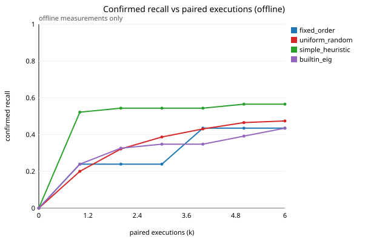
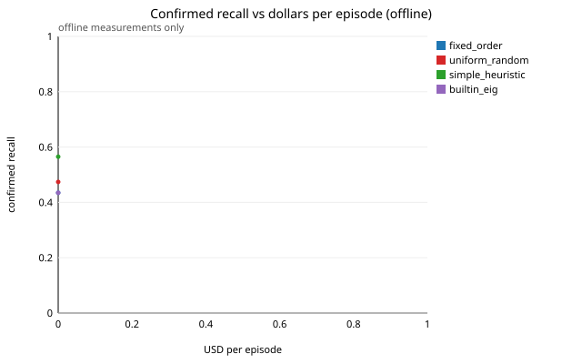
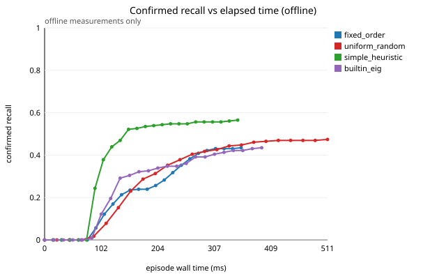
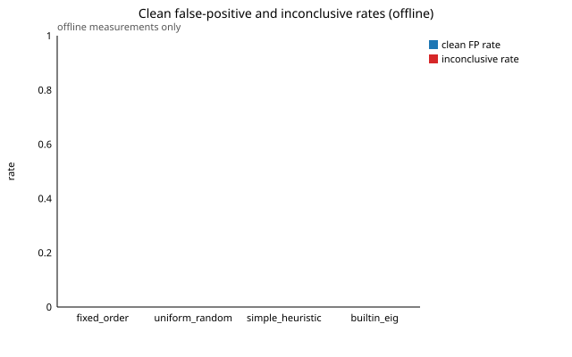
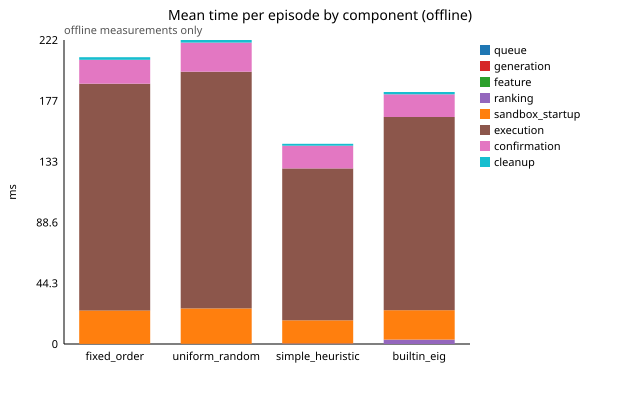

No ledger entries recorded for offline measurements.

## Live measurements

Live measurements: real provider calls and sandbox executions. Only these may be described as live cloud latency or cost.

### live / validation split

Recall: share of defect cases with a label-matched confirmed witness within k pairs, mean over seeds, 95% percentile bootstrap grouped by defect family (10000 resamples, seed 20261107).

| arm | runs | recall@1 | recall@3 | recall@6 | precision | clean FP runs | inconclusive | censored defect runs | median pairs (detected only) |
|---|---|---|---|---|---|---|---|---|---|
| frontier_reviewer | 250 | 0.674 [0.618, 0.727] | 0.674 [0.618, 0.727] | 0.674 [0.618, 0.727] | 1.000 | 0/20 | 0/250 | 75/230 (at 6) | 1.0 |
| frontier_agent | 250 | 0.735 [0.597, 0.871] | 0.761 [0.650, 0.893] | 0.761 [0.650, 0.893] | 1.000 | 0/20 | 0/250 | 55/230 (at 6) | 1.0 |

Case-level (ungrouped) recall intervals:

| arm | recall@1 | recall@3 | recall@6 |
|---|---|---|---|
| frontier_reviewer | 0.674 [0.543, 0.804] | 0.674 [0.543, 0.804] | 0.674 [0.543, 0.804] |
| frontier_agent | 0.735 [0.604, 0.861] | 0.761 [0.630, 0.870] | 0.761 [0.630, 0.870] |

Speed and cost (unknown costs are not counted as zero; estimated costs are labelled and are not provider-measured):

| arm | p50/p95 wall ms | p50 time to witness ms (detected) | cold/warm p50 ms | base/head/confirm/failed | known cost | estimated-cost runs | unknown-cost runs | $/case | $/confirmed defect | confirmation rate |
|---|---|---|---|---|---|---|---|---|---|---|
| frontier_reviewer | 2090.7/3890.9 | 2696.9 | NA/NA | 725/725/155/0 | $0.6754 | 0 | 0 | $0.0135 | $0.0044 | 1.000 |
| frontier_agent | 1687.4/9339.5 | 1516.8 | NA/NA | 631/631/175/0 | $2.5310 | 0 | 0 | $0.0506 | $0.0145 | 1.000 |

Inconclusive and failed runs by reason:

| arm | verdict:reason | runs |
|---|---|---|
| - | - | 0 |

Degraded episodes (provider failure, fell back to fixed order). They are counted as the arm's own results, including outcome and cost:

| arm | runs | degraded runs | degraded rate | reason | reason runs | reason rate | degraded known cost | degraded confirmed defects |
|---|---|---|---|---|---|---|---|---|
| frontier_reviewer | 250 | 100 | 0.400 | empty_ranking | 100 | 0.400 | $0.2313 | 5 |
| frontier_agent | 250 | 0 | 0.000 | none | 0 | 0.000 | $0.0000 | 0 |

Per-family recall@6 (cases):

| arm | ceil_rounding | discount_floor_min | drop_max_item | skip_index |
|---|---|---|---|---|
| frontier_reviewer | 0.667 (3) | 0.737 (19) | 0.600 (5) | 0.632 (19) |
| frontier_agent | 1.000 (3) | 0.842 (19) | 0.800 (5) | 0.632 (19) |

Replicate spread (recall at max budget, per preregistered seed):

| arm | per-seed recall | spread |
|---|---|---|
| frontier_reviewer | 0.674, 0.674, 0.674, 0.674, 0.674 | 0.000 |
| frontier_agent | 0.761, 0.761, 0.761, 0.761, 0.761 | 0.000 |

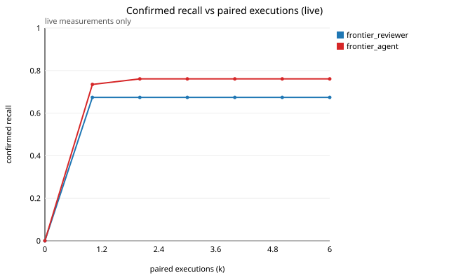
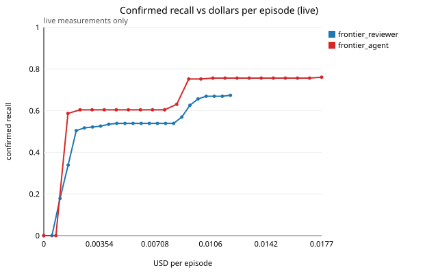
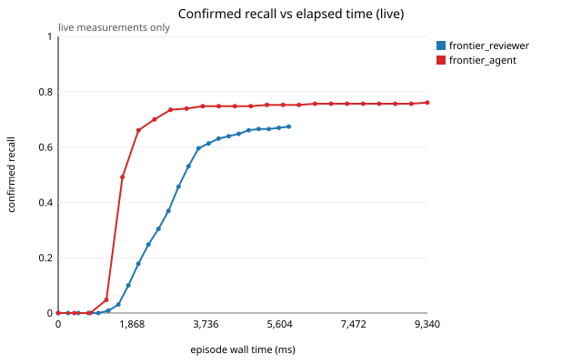
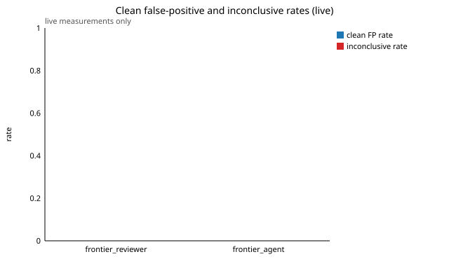
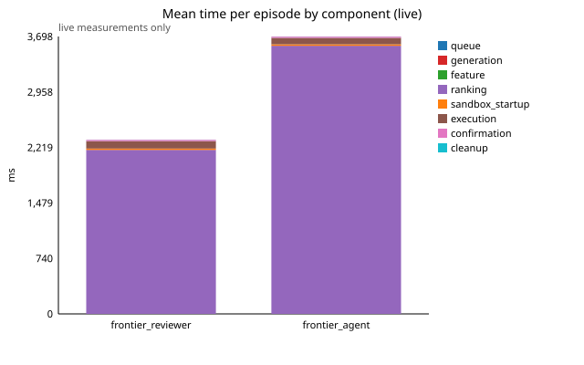

Cost/timing ledger (live only; includes failed and retried calls; estimated amounts are labelled and are not provider-measured):

| category | phase | entries | paid | measured (entries) | estimated (entries) | unknown-cost entries | wall ms | providers |
|---|---|---|---|---|---|---|---|---|
| model_inference | pilot | 881 | 881 | $3.2064 (881) | - | 0 | 1429773 | openai |

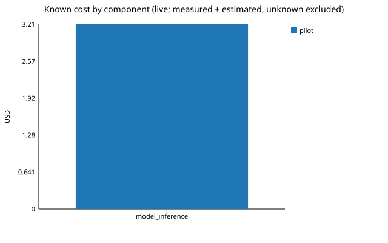
